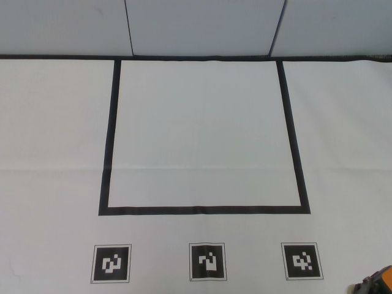

# Classification area — reference view

Robot view standing at the classification area on 2026-11-23, D435 colour camera
(`/camera/color/image_raw`), 640×480. This is the pose the robot must reach before
classifying.

## What the frame shows

- A large **black-bordered square** painted on the floor, centred in the frame.
- **Three dark ArUco markers** along the bottom edge: left ≈ (185, 430),
  centre ≈ (335, 430), right ≈ (490, 430).
- Arm parked out of the way at Cartesian (70, −140, 30) mm so it only clips the
  bottom-right corner.

## Pose

| item | value |
| --- | --- |
| A (collection square) | map (0.225, 2.775), heading **270° (south)** |
| Route from A | 1.00 m forward → 90° left → 0.10 m forward |
| Classification area | map **(0.323, 1.776), heading ≈0° (east)** |
| Odom at the area | (−0.769, 0.666), yaw −128.6° (2026-11-23 boot) |
| Front clearance | 0.35 m to the shelf at the final stand-off |

See `simulation/robot/anchor_A.json` and `anchor_classification.json` for the
machine-readable anchors.

## Notes

- The arena's north side is **open** (no wall); map coordinates north of y ≈ 3.0
  are A-relative, not inside the drawn map.
- The map's west-wall block (x 0–0.40, y 1.30–1.70) is where the classification
  shelf stands — this frame is taken beside it. The table is **between A and D**
  (user-confirmed 2026-11-23; the guidelines contradict themselves with an
  "A and C" sentence in the 布局图示 section — treat that as a typo).
- The camera stream is at `http://<robot-ip>:8080/` (`/snapshot.jpg` for a still).
